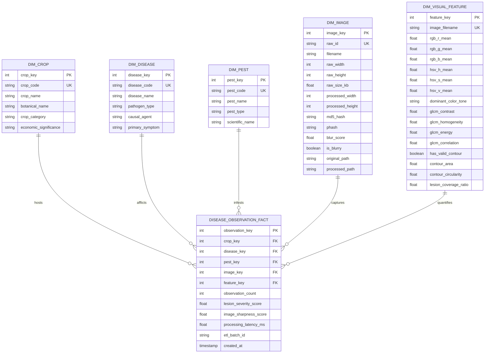

# Star Schema Entity-Relationship Specification

## 1. Dimensional Architecture Diagram

---

## 2. Table Indexing & Physical Storage Strategy

| Table Name | Index Name | Indexed Columns | Index Purpose |
| :--- | :--- | :--- | :--- |
| `dim_crop` | `idx_dim_crop_category` | `crop_category` | Speeds up Roll-up and Drill-down operations |
| `dim_disease` | `idx_dim_disease_pathogen`| `pathogen_type` | Speeds up Slice and Dice by pathogen class |
| `dim_image` | `idx_dim_image_hash` | `md5_hash` | O(1) duplicate checks and lookup |
| `dim_visual_feature` | `idx_dim_feature_tone` | `dominant_color_tone` | Enables rapid visual tone filtering |
| `disease_observation_fact`| `idx_fact_crop_disease` | `crop_key, disease_key` | High-frequency fact join optimization |
| `disease_observation_fact`| `idx_fact_crop_pathogen`| `crop_key, disease_key, pest_key` | Multi-dimensional aggregation acceleration |
