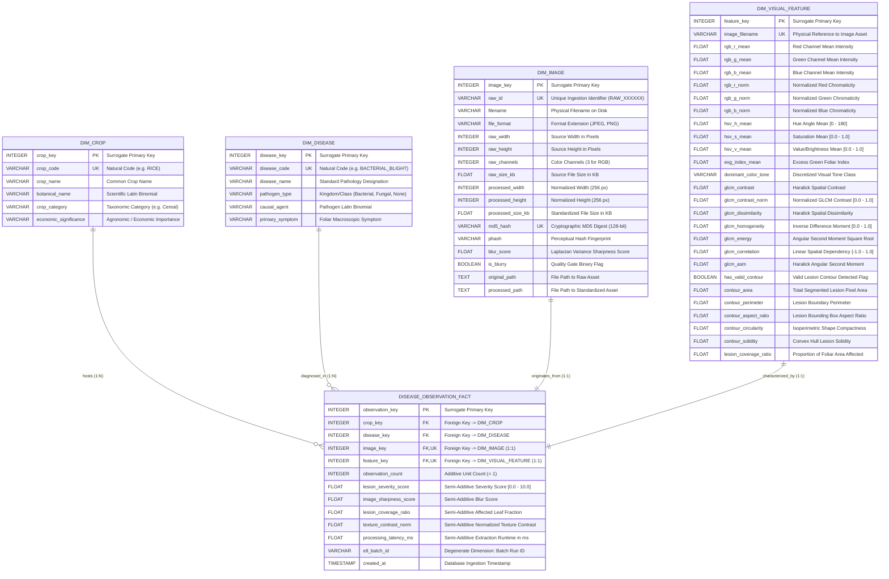

# AgroVision-Mine: Star Schema Specification & Relational Architecture

## 1. Schema Philosophy & Entity-Relationship Model

The **AgroVision-Mine Multimodal Data Warehouse** is structured as a **Star Schema** centered on the `disease_observation_fact` table, surrounded by four verified, ground-truth-supported dimension tables:
1. **`dim_crop`** (Host plant taxonomy and hierarchy)
2. **`dim_disease`** (Pathology diagnosis and pathogen taxonomy)
3. **`dim_image`** (Optical properties, dimensions, cryptographic hashes, and storage paths)
4. **`dim_visual_feature`** (44 explainable color, GLCM texture, and morphometric shape descriptors)

### 1.1 Star Schema ERD Diagram



---

## 2. Relational Table Specifications

### 2.1 Central Fact Table: `disease_observation_fact`
- **Grain:** Exactly **one record per validated, preprocessed multimodal agricultural image observation**.
- **Role:** Central aggregation point linking physical plant observations with taxonomy, optical qualities, and visual metrics.

| Column | Data Type | Constraint | Description |
|---|---|---|---|
| `observation_key` | `INTEGER` | `PRIMARY KEY AUTOINCREMENT` | Surrogate primary key |
| `crop_key` | `INTEGER` | `NOT NULL`, `FK -> dim_crop(crop_key)` | Link to host crop dimension |
| `disease_key` | `INTEGER` | `NOT NULL`, `FK -> dim_disease(disease_key)` | Link to pathology dimension |
| `image_key` | `INTEGER` | `NOT NULL UNIQUE`, `FK -> dim_image(image_key)` | 1:1 Link to technical image dimension |
| `feature_key` | `INTEGER` | `NOT NULL UNIQUE`, `FK -> dim_visual_feature(feature_key)` | 1:1 Link to visual feature dimension |
| `observation_count` | `INTEGER` | `NOT NULL DEFAULT 1` | Additive measure for observation frequency |
| `lesion_severity_score` | `FLOAT` | `NOT NULL DEFAULT 0.0` | Semi-additive severity estimate $[0.0, 10.0]$ |
| `image_sharpness_score` | `FLOAT` | `NOT NULL DEFAULT 0.0` | Semi-additive Laplacian blur score |
| `lesion_coverage_ratio` | `FLOAT` | `NOT NULL DEFAULT 0.0` | Semi-additive proportion of foliar lesion area $[0.0, 1.0]$ |
| `texture_contrast_norm` | `FLOAT` | `NOT NULL DEFAULT 0.0` | Semi-additive normalized GLCM texture contrast $[0.0, 1.0]$ |
| `processing_latency_ms` | `FLOAT` | `NOT NULL DEFAULT 0.0` | Semi-additive pipeline processing time in ms |
| `etl_batch_id` | `VARCHAR(50)` | `NOT NULL` | Degenerate attribute tracking ETL run |
| `created_at` | `TIMESTAMP` | `DEFAULT CURRENT_TIMESTAMP` | Lineage timestamp of record creation |

---

### 2.2 Dimension Table: `dim_crop`
- **Role:** Host plant taxonomy and agronomic classification.
- **Hierarchy:** Crop Name $\rightarrow$ Crop Category (e.g. Rice $\rightarrow$ Cereal).

| Column | Data Type | Constraint | Description |
|---|---|---|---|
| `crop_key` | `INTEGER` | `PRIMARY KEY AUTOINCREMENT` | Surrogate key |
| `crop_code` | `VARCHAR(50)` | `NOT NULL UNIQUE` | Natural identifier (`RICE`) |
| `crop_name` | `VARCHAR(100)` | `NOT NULL` | Common name (`Rice`) |
| `botanical_name` | `VARCHAR(150)` | `NOT NULL` | Scientific binomial (*Oryza sativa*) |
| `crop_category` | `VARCHAR(50)` | `NOT NULL` | Broad category (`Cereal`, `Fiber`) |
| `economic_significance`| `VARCHAR(100)`| `DEFAULT 'Commercial Staple'` | Agronomic role |

---

### 2.3 Dimension Table: `dim_disease`
- **Role:** Pathology taxonomy, causal agent, and diagnostic symptoms.
- **Hierarchy:** Specific Disease $\rightarrow$ Pathogen Type (e.g. Bacterial Blight $\rightarrow$ Bacterial; Brown Spot $\rightarrow$ Fungal).

| Column | Data Type | Constraint | Description |
|---|---|---|---|
| `disease_key` | `INTEGER` | `PRIMARY KEY AUTOINCREMENT` | Surrogate key |
| `disease_code` | `VARCHAR(50)` | `NOT NULL UNIQUE` | Natural identifier (`BACTERIAL_BLIGHT`, `BROWN_SPOT`) |
| `disease_name` | `VARCHAR(150)` | `NOT NULL` | Pathology name (`Bacterial Leaf Blight`) |
| `pathogen_type` | `VARCHAR(50)` | `NOT NULL` | Taxonomic type (`Bacterial`, `Fungal`, `None`) |
| `causal_agent` | `VARCHAR(150)` | `DEFAULT 'Unspecified'` | Microbial agent (*Xanthomonas oryzae*, *Bipolaris oryzae*) |
| `primary_symptom` | `VARCHAR(200)` | `DEFAULT 'Foliar lesion'`| Visual macroscopic manifestation |

---

### 2.4 Dimension Table: `dim_image`
- **Role:** Technical image characteristics, standardization parameters, hashes, and storage paths.

| Column | Data Type | Constraint | Description |
|---|---|---|---|
| `image_key` | `INTEGER` | `PRIMARY KEY AUTOINCREMENT` | Surrogate key |
| `raw_id` | `VARCHAR(50)` | `NOT NULL UNIQUE` | Ingestion identifier (`RAW_000002`) |
| `filename` | `VARCHAR(255)` | `NOT NULL` | Original filename on disk (`DSC_0365.JPG`) |
| `file_format` | `VARCHAR(20)` | `NOT NULL` | Image format (`JPEG`, `PNG`) |
| `raw_width` | `INTEGER` | `NOT NULL` | Source width in pixels |
| `raw_height` | `INTEGER` | `NOT NULL` | Source height in pixels |
| `raw_channels` | `INTEGER` | `NOT NULL DEFAULT 3` | Source color channels |
| `raw_size_kb` | `FLOAT` | `NOT NULL` | Source file size in kilobytes |
| `processed_width`| `INTEGER` | `DEFAULT 256` | Standardized width in pixels |
| `processed_height`| `INTEGER` | `DEFAULT 256` | Standardized height in pixels |
| `processed_size_kb`| `FLOAT` | `NOT NULL` | Processed file size in kilobytes |
| `md5_hash` | `VARCHAR(64)` | `NOT NULL UNIQUE` | 128-bit cryptographic MD5 hash |
| `phash` | `VARCHAR(32)` | `NULLABLE` | Perceptual difference hash fingerprint |
| `blur_score` | `FLOAT` | `DEFAULT 0.0` | Laplacian variance sharpness measure |
| `is_blurry` | `BOOLEAN` | `DEFAULT 0` | Binary quality gate flag |
| `original_path` | `TEXT` | `NOT NULL` | Relative or absolute path to raw image |
| `processed_path` | `TEXT` | `NOT NULL` | Relative or absolute path to normalized image |

---

### 2.5 Dimension Table: `dim_visual_feature`
- **Role:** Explainable visual descriptors extracted from standardized foliar images.

| Feature Category | Columns | Data Type | Description |
|---|---|---|---|
| **Identity** | `feature_key` (PK), `image_filename` (UK) | `INTEGER`, `VARCHAR` | Surrogate key and image filename link |
| **Color Moments** | `rgb_r_mean`, `rgb_g_mean`, `rgb_b_mean`, `rgb_r_std`, `rgb_g_std`, `rgb_b_std` | `FLOAT` | 1st and 2nd statistical moments of RGB color channels |
| **Normalized RGB** | `rgb_r_norm`, `rgb_g_norm`, `rgb_b_norm` | `FLOAT` | Chromaticity proportions: $\frac{C}{R+G+B}$ |
| **HSV Space** | `hsv_h_mean`, `hsv_s_mean`, `hsv_v_mean`, `hsv_h_norm`, `hsv_s_norm`, `hsv_v_norm` | `FLOAT` | Cylindrical color coordinates and normalized metrics |
| **Vegetation Index** | `exg_index_mean` | `FLOAT` | Excess Green Index: $2G - R - B$ |
| **Visual Tone** | `dominant_color_tone` | `VARCHAR(50)` | Discretized tone class (`Foliar_Green`, `Lesion_Brown`, etc.) |
| **GLCM Textures** | `glcm_contrast`, `glcm_contrast_norm`, `glcm_dissimilarity`, `glcm_homogeneity`, `glcm_energy`, `glcm_correlation`, `glcm_asm` | `FLOAT` | Haralick spatial gray-level co-occurrence matrix descriptors |
| **Shape Metrics** | `has_valid_contour`, `contour_area`, `contour_perimeter`, `contour_aspect_ratio`, `contour_circularity`, `contour_solidity`, `lesion_coverage_ratio` | `BOOLEAN`, `FLOAT` | Morphometric lesion contour descriptors and coverage fraction |

---

## 3. Query Optimization & Indexing Strategy

To guarantee sub-second execution on complex OLAP queries (Roll-up, Drill-down, Slice, Dice, Pivot), the warehouse defines physical B-Tree indices:

| Index Name | Table | Indexed Columns | Analytical Purpose |
|---|---|---|---|
| `idx_dim_crop_category` | `dim_crop` | `crop_category` | Accelerates category-level Roll-up queries |
| `idx_dim_crop_code` | `dim_crop` | `crop_code` | Accelerates natural key lookups during ETL |
| `idx_dim_disease_pathogen` | `dim_disease` | `pathogen_type` | Optimizes Pathogen Type slicing and pivoting |
| `idx_dim_disease_code` | `dim_disease` | `disease_code` | Accelerates disease key resolution |
| `idx_dim_image_raw_id` | `dim_image` | `raw_id` | Ingestion identifier lookups |
| `idx_dim_image_hash` | `dim_image` | `md5_hash` | Duplicate detection and cryptographic audit |
| `idx_dim_feature_tone` | `dim_visual_feature` | `dominant_color_tone` | Accelerates color-based filtering and dicing |
| `idx_dim_feature_contrast`| `dim_visual_feature` | `glcm_contrast_norm` | Optimizes texture threshold predicates |
| `idx_fact_crop_disease` | `disease_observation_fact`| `crop_key, disease_key` | Compound index for cross-dimensional filtering |
| `idx_fact_batch` | `disease_observation_fact`| `etl_batch_id` | Accelerates batch audit and lineage tracking |

---

## 4. Referential Integrity & Constraints Matrix

| Constraint Type | Table | Columns | Rule / Enforcement |
|---|---|---|---|
| **Primary Key** | All Tables | `*_key` | Surrogate integer, auto-incrementing, non-null |
| **Foreign Key** | `disease_observation_fact` | `crop_key` | References `dim_crop.crop_key` (`ON DELETE RESTRICT`) |
| **Foreign Key** | `disease_observation_fact` | `disease_key` | References `dim_disease.disease_key` (`ON DELETE RESTRICT`) |
| **Foreign Key** | `disease_observation_fact` | `image_key` | References `dim_image.image_key` (`ON DELETE RESTRICT`) |
| **Foreign Key** | `disease_observation_fact` | `feature_key` | References `dim_visual_feature.feature_key` (`ON DELETE RESTRICT`) |
| **Unique** | `dim_crop` | `crop_code` | Guarantees uniqueness of crop natural code |
| **Unique** | `dim_disease` | `disease_code` | Guarantees uniqueness of disease code |
| **Unique** | `dim_image` | `raw_id`, `md5_hash` | Prevents duplicate physical or cryptographic assets |
| **Unique** | `dim_visual_feature` | `image_filename` | Enforces 1:1 correspondence between image and feature vector |
| **Unique** | `disease_observation_fact` | `image_key`, `feature_key` | Enforces exact 1:1 observation grain per preprocessed image |

---

## 5. Verification Commands

To verify and inspect the Star Schema physical deployment:

```bash
# 1. Initialize schema cleanly
python run.py --stage init-db --drop-existing

# 2. Run automated schema and constraints verification
python scripts/verify_schema.py

# 3. Run full test suite including Phase 4 schema tests
pytest tests/test_warehouse_phase4.py -v
```
